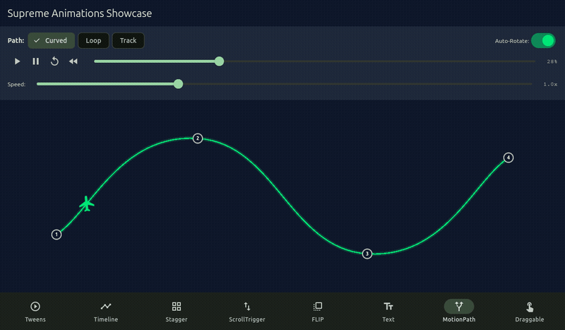
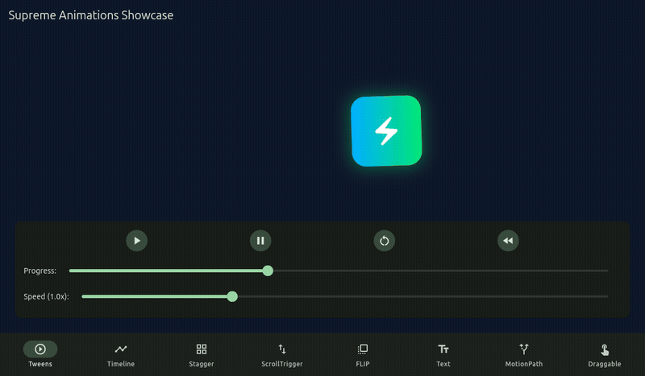
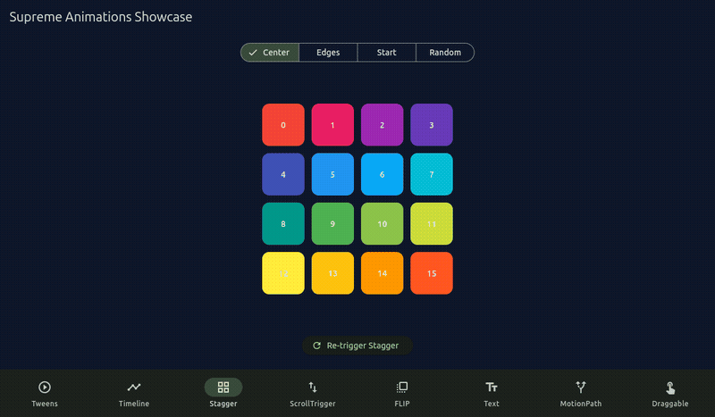
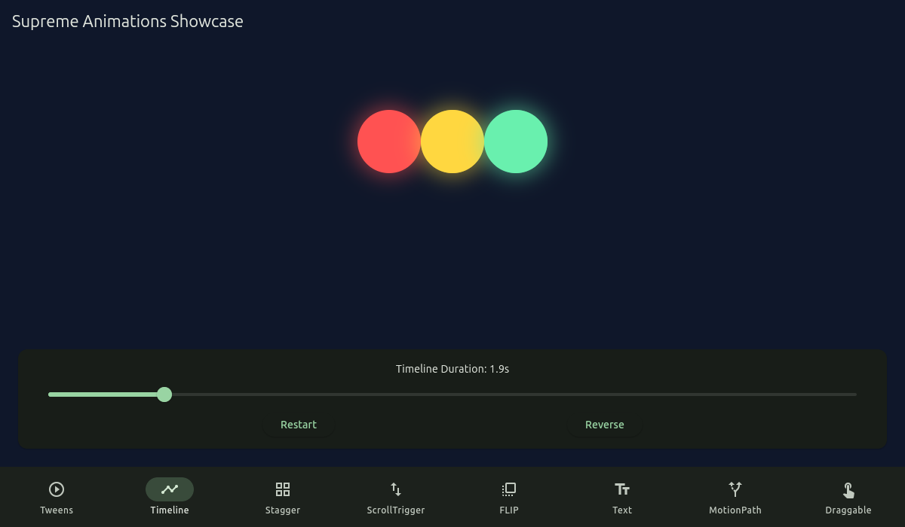
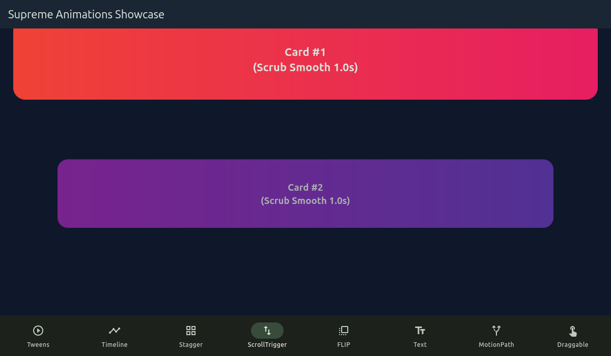
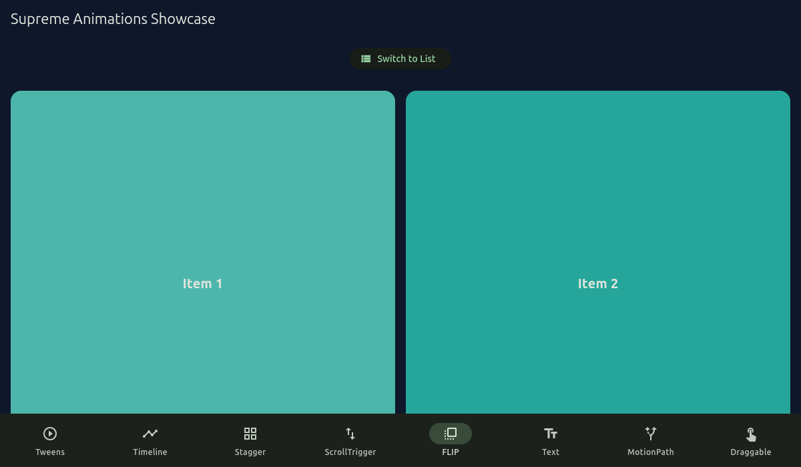
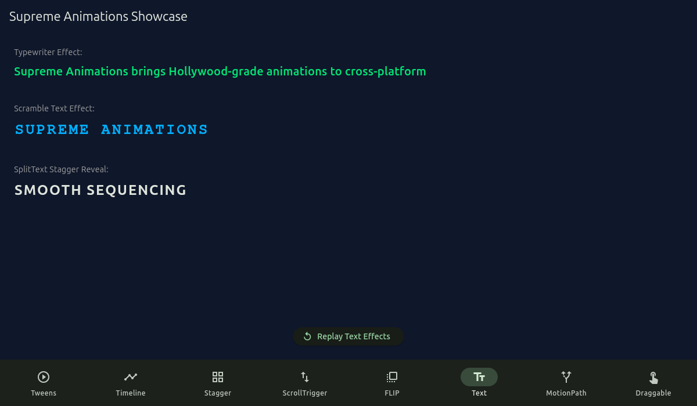
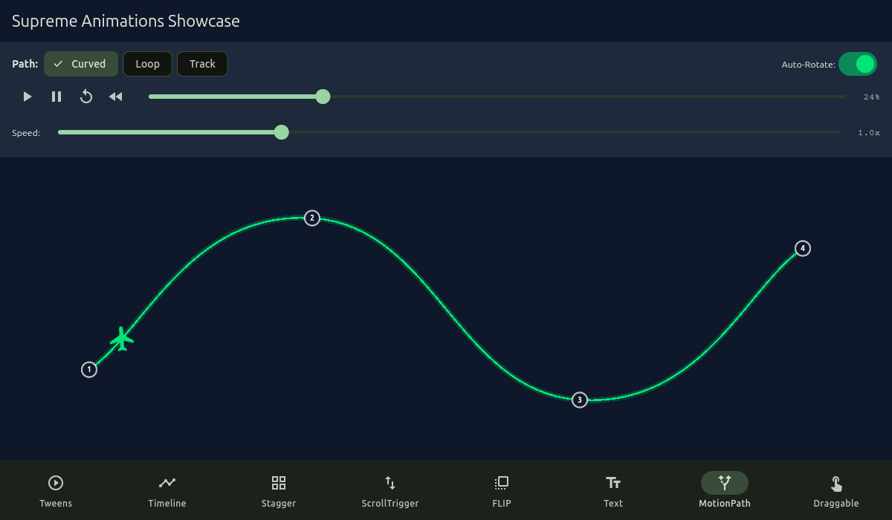
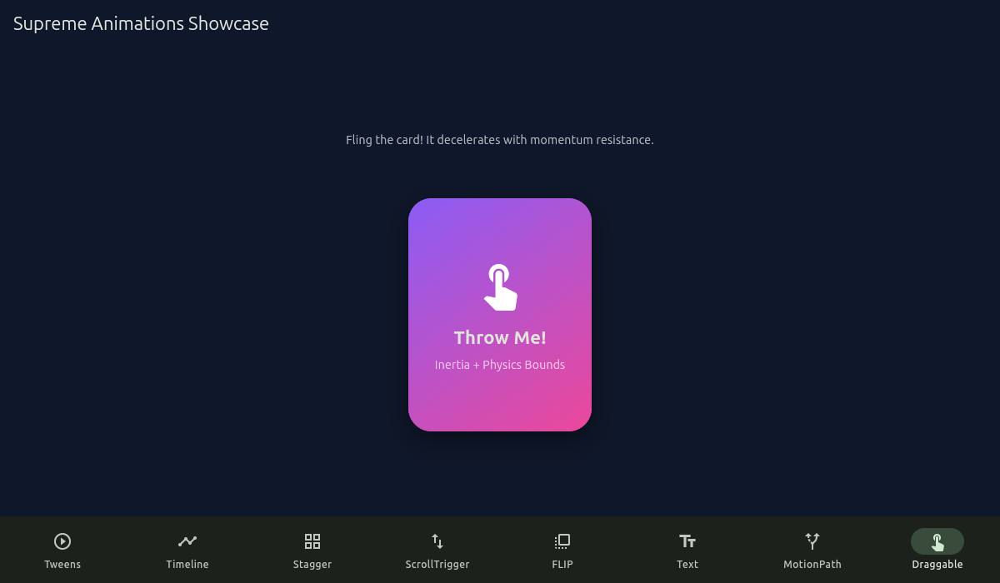

# Supreme Animations ⚡

A high-performance, feature-complete animation library for Flutter that brings the full power, syntax, and choreography flexibility of modern professional animation engines to cross-platform mobile, desktop, and web applications.

---

## 🎬 Live Demos & Visual Showcase

Experience smooth 60fps animations, timeline sequencing, and physics across Flutter (iOS, Android, Web, Windows, macOS, Linux):

| ✈️ MotionPath with Auto-Rotate | ⏱️ Multi-Track Timeline Sequencing |
| :---: | :---: |
|  |  |

| ⚡ Interactive Tweens & Live Scrubbing | 🔲 2D Grid Staggers & Cascades |
| :---: | :---: |
|  |  |

<details>
<summary><b>📸 Click to view the complete showcase gallery (8 Interactive Screens)</b></summary>
<br>

| Showcase Screen | Key Capabilities Demonstrated | Preview |
| :--- | :--- | :---: |
| **01. Tweens & Controls** | Real-time interactive progress scrub bar, speed scaling (0.2x - 3.0x), play/pause/reverse controls |  |
| **02. Timeline Choreography** | Multi-orb sequenced choreography with overlap operators (`<0.15`), reverse, and label cues |  |
| **03. 2D Grid Staggers** | 4x4 matrix stagger cascading from center, edges, start, or random directions |  |
| **04. ScrollTrigger** | Smooth scroll-driven container animations with scrub damping and pinned trigger boundaries |  |
| **05. FLIP Layout Morphs** | Seamless layout reordering and view morphing between grid and list without abrupt jumping |  |
| **06. Text Effects & SplitText** | Typewriter reveal, scramble text decryption, and staggered character reveals |  |
| **07. MotionPath Splines** | Curvilinear Bezier path traversal with dynamic tangents and automatic rotation orientation |  |
| **08. Draggable & Inertia** | Physics-based gesture tossing with momentum deceleration and boundary rebound |  |

</details>

---

## 🚀 Features

- **Core Tweening Engine (`supreme.to`, `supreme.from`, `supreme.fromTo`, `supreme.set`)**:
  - High-precision frame loop (`supreme.ticker`) with lag smoothing and FPS throttling
  - Strongly-typed `SupremeVars` and dynamic map configuration
  - Relative value syntax (`"+=50"`, `"-=20"`, `"*=2"`, `"/=2"`)
  - Multi-step Keyframes sequencing (`keyframes: [...]`)
  - Modifiers plugin (`SupremeModifiers.snap`, `clamp`, `wrap`, `pipe`)
  - `supreme.quickTo()` and `supreme.quickSetter()` for maximum throughput during gesture tracking
  - Full animation controls: `play()`, `pause()`, `resume()`, `reverse()`, `restart()`, `seek()`, `timeScale()`, `progress()`, `kill()`
  - Loops: `repeat` (-1 for infinite), `repeatDelay`, `yoyo`, `yoyoEase`
  - Awaitable tweens: `await supreme.to(...)`

- **Timeline Choreography (`supreme.timeline()`)**:
  - Sequence animations seamlessly with nesting to arbitrary depth
  - Position parameter:
    - Absolute time (`1.5`)
    - Relative offset (`"+=0.5"`, `"-=0.2"`)
    - Start-relative `<` (align with start of previous) and `<0.2`
    - End-relative `>` (align with end of previous) and `>0.2`
    - Named labels (`tl.addLabel("spin")`, `"spin+=0.3"`)
  - Defaults inheritance across child animations

- **Comprehensive Easing Suite**:
  - Standard curves: `power1`, `power2`, `power3`, `power4`, `sine`, `expo`, `circ` with `.easeIn`, `.out`, `.inOut`
  - Configurable physics eases:
    - `Ease.back.out(overshoot)`
    - `Ease.elastic.out(amplitude, period)`
    - `Ease.bounce.out`
    - `Ease.steps(count)`
  - `CubicBezier(x1, y1, x2, y2)` with Newton-Raphson solver
  - `CustomEase.create(id, svgPath)` SVG path data parser
  - `RoughEase` for electric flicker and earthquake jitter
  - `SlowMo` for slow-motion easing with optional yoyo

- **Stagger Engine (`supreme.stagger` / `Stagger`)**:
  - 1D staggers with `from`: `start`, `end`, `center`, `edges`, `random`, or specific index
  - 2D grid staggers `[rows, cols]` with Manhattan/Euclidean distance and axis constraints (`'x'`, `'y'`)
  - Distribute delays with an easing curve (`ease`)

- **Flutter Widget Integration**:
  - `SupremeWidget`: hardware-accelerated 2D/3D transforms (`x`, `y`, `z`, `scale`, `rotation`, `rotationX`, `rotationY`, `skewX`, `skewY`, `opacity`, `blur`, `origin`)
  - Extension method: `myWidget.supreme(...)`
  - `SupremeBuilder`: reactive widget builder
  - `SupremeStateMixin`: lifecycle-safe auto-cleanup of animations

- **Flagship Plugins**:
  - **ScrollTrigger**: Connect tweens/timelines to scroll containers with `start`/`end` triggers, `scrub` (with lag smoothing), `pin`, `toggleActions`, callbacks, and visual debug `markers`.
  - **FLIP Plugin**: First, Last, Invert, Play for layout morphing (grid to list transitions without abrupt jumps).
  - **TextPlugin & SplitText**: Typewriter effect, character scramble, and staggered character/word reveals.
  - **MotionPath Plugin**: Fly elements along curved 2D Bezier splines with `autoRotate`.
  - **Draggable & Inertia**: Physics-based drag-and-throw gesture manipulation with deceleration momentum and boundary clamping.

---

## 📦 Installation

Add `supreme_animations` to your `pubspec.yaml`:

```yaml
dependencies:
  supreme_animations: ^1.0.0
```

Import `supreme_animations.dart`:

```dart
import 'package:supreme_animations/supreme_animations.dart';
```

---

## 📖 Quick Start

### 1. Basic Tweening

```dart
final props = TransformProps();

// Tween TO destination values
supreme.to(props, {
  'x': 100.0,
  'rotation': 3.14159,
  'scale': 1.5,
  'duration': 1.2,
  'ease': Ease.elastic.out,
  'repeat': -1,
  'yoyo': true,
});

// Bind to widget
SupremeWidget(
  transform: props,
  child: MyCard(),
)
```

You can also use the strongly-typed `SupremeVars` and the widget extension:

```dart
MyCard().supreme(
  to: SupremeVars(
    x: 100,
    rotationDeg: 180,
    scale: 1.2,
    duration: 1.0,
    ease: Ease.back.out,
  ),
)
```

### 2. Timelines & Sequencing

```dart
final tl = supreme.timeline({
  'defaults': {'duration': 0.8, 'ease': Ease.power2.out},
});

tl.to(headerProps, {'y': 0.0, 'opacity': 1.0})
  .to(cardProps, {'scale': 1.0, 'opacity': 1.0}, '<0.2') // Starts 0.2s after header starts
  .addLabel('buttons')
  .to(btn1Props, {'x': 0.0}, 'buttons')
  .to(btn2Props, {'x': 0.0}, 'buttons+=0.1');

// Playback controls
tl.pause();
tl.resume();
tl.reverse();
tl.seek(1.5);
tl.timeScale(2.0); // 2x playback speed
```

### 3. Grid Staggers

```dart
final List<TransformProps> items = List.generate(16, (_) => TransformProps());

supreme.fromTo(
  items,
  {'scale': 0.0, 'opacity': 0.0},
  {
    'scale': 1.0,
    'opacity': 1.0,
    'duration': 0.6,
    'ease': Ease.back.out,
    'stagger': {
      'amount': 0.8,
      'from': 'center',
      'grid': [4, 4],
    },
  },
);
```

### 4. ScrollTrigger

```dart
ScrollTriggerScope(
  child: ScrollTriggerMarkersOverlay(
    child: ListView(
      children: [
        ScrollTriggerWidget(
          start: 'top 80%',
          end: 'center 30%',
          scrub: 1.0, // 1-second lag smoothed scrub
          markers: true, // Display visual debug markers
          from: {
            'y': 100.0,
            'scale': 0.7,
            'opacity': 0.0,
          },
          child: FeaturedProductCard(),
        ),
      ],
    ),
  ),
)
```

### 5. FLIP Layout Morphing

```dart
void toggleLayout() {
  // 1. Record geometry
  final state = Flip.getState(cardKeys);

  // 2. Change state (e.g. grid to list)
  setState(() {
    isGrid = !isGrid;
  });

  // 3. Smoothly animate between disparate layout states
  WidgetsBinding.instance.addPostFrameCallback((_) {
    Flip.from(
      state,
      transformPropsMap: cardProps,
      duration: 0.6,
      ease: Ease.power3.out,
    );
  });
}
```

### 6. TextPlugin & SplitText

```dart
// Typewriter
final titleNotifier = ValueNotifier<String>('');
TextPlugin.typewriter(titleNotifier, 'Welcome to Supreme Animations!', duration: 2.0);

// Scramble text
final codeNotifier = ValueNotifier<String>('XXXXXXXX');
TextPlugin.scramble(codeNotifier, 'SECRET_KEY', duration: 1.5);

// SplitText staggered character reveal
SplitTextWidget(
  text: 'HOLLYWOOD GRADE',
  type: SplitType.chars,
  stagger: 0.04,
  duration: 0.8,
  from: {'y': 50.0, 'opacity': 0.0},
)
```

### 7. MotionPath (Curved Splines with Auto-Rotation)

```dart
final path = MotionPath.curved([
  const Offset(0, 0),
  const Offset(150, 80),
  const Offset(300, 20),
]);

final tween = MotionPathTween(
  target: planeProps,
  path: path,
  autoRotate: true,
  duration: 3.0,
  ease: Ease.power2.inOut,
);
```

### 8. Draggable & Inertia

```dart
SupremeDraggable(
  inertia: true, // Decelerates with physics momentum
  bounds: const Rect.fromLTWH(-100, -100, 200, 200),
  snapStep: const Offset(50, 50), // Optional grid snapping
  child: FloatingActionCard(),
)
```

---

## 🧪 Testing

Supreme Animations comes with a full test suite verifying mathematical precision, timing accuracy, widget transformations, and plugins:

```bash
flutter test
```

---

## 🎮 Showcase App

Supreme Animations includes a rich, interactive showcase app displaying each feature and plugin in action:

```bash
cd example
flutter run
```

Features demonstrated in the app:
1. **Tweens & Controls**: Interactive play/pause/reverse, timeline scrubbing slider, speed multiplier, elastic box.
2. **Timeline Choreography**: Multi-orb sequenced choreography with position parameters (`<`, labels).
3. **2D Grid Stagger**: 4x4 card grid reveal with directional staggering (`center`, `edges`, `start`, `random`).
4. **ScrollTrigger**: Scrollview with scrubbed cards, start/end trigger points, and debug markers.
5. **FLIP Layout Transitions**: Animated morphing between 2-column Grid and 1-column List layouts.
6. **Text Effects**: Typewriter effect, matrix character scramble, and staggered SplitText.
7. **MotionPath**: Airplane icon flying on a curved cubic Bezier spline with `autoRotate`.
8. **Draggable & Inertia**: Momentum card throw and fling with boundary clamping.

---

## 📄 License

MIT License.
